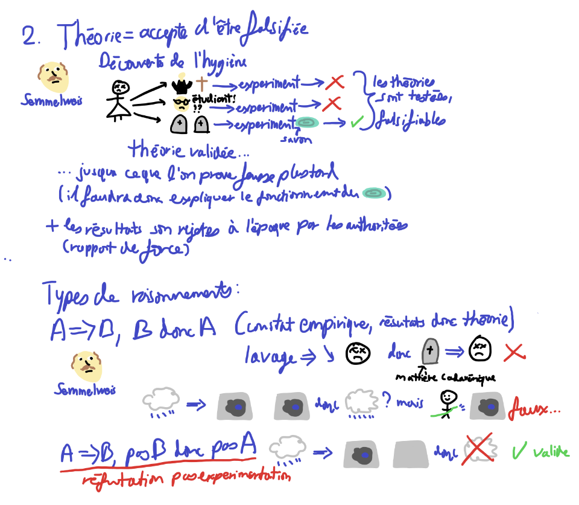

During my grade 12 philosophy course, I made a large collections of drawings in a cartoon style to explain all of the concepts we were studying in class simply, and as easy study tools.

This course was taken in french, so the notes and drawings are almost in french.

The pages are all very big, and done in MS Paint using my mouse:

- Questions 1-3 on Epistemology, Demonstrations, Truth and Science: [link](/assets/img/projects/other/PhilosophieQ1-3.webp)
- Question 4 on Technology: [link](/assets/img/projects/other/PhilosophieQ4.webp)
- Questions 5-8 on Work, Inequality, State and Justice: [link](/assets/img/projects/other/PhilosophieQ5-8.png)
- Questions 9-11 on Spirit, Conscience and Language: [link](/assets/img/projects/other/PhilosophieQ9-11.webp)
- Questions 12-15 on Happiness, Religion and Art: [link](/assets/img/projects/other/PhilosophieQ12-15.webp)
- Mega synthesis sheet recapping all of the above ones with drawings and short notes: [link](/assets/img/projects/other/PhiloPlansQuestionsQ1-15.webp)

They were made based off my understanding of the concepts, and though my professor said that they generally made sense, these should only be used as a compliment to following along in class and reading the material. I could have totally misunderstood things.

Also there may be many spelling mistakes!
